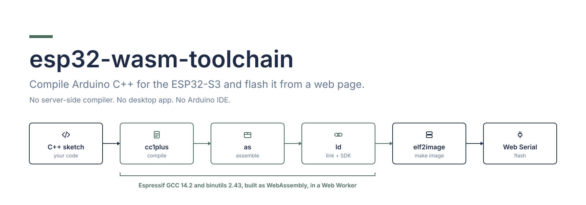
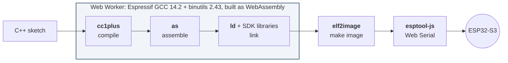
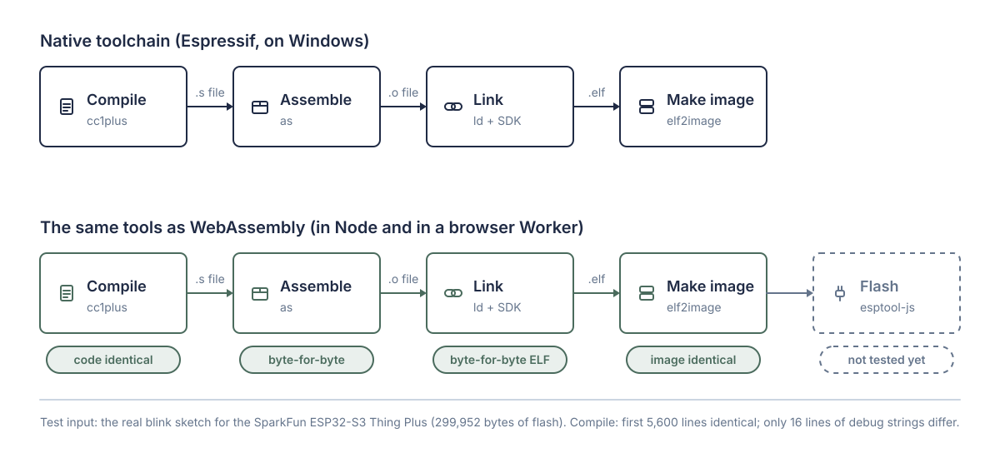
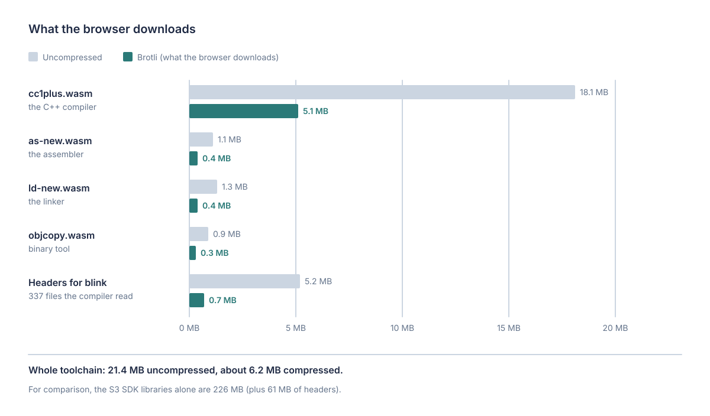
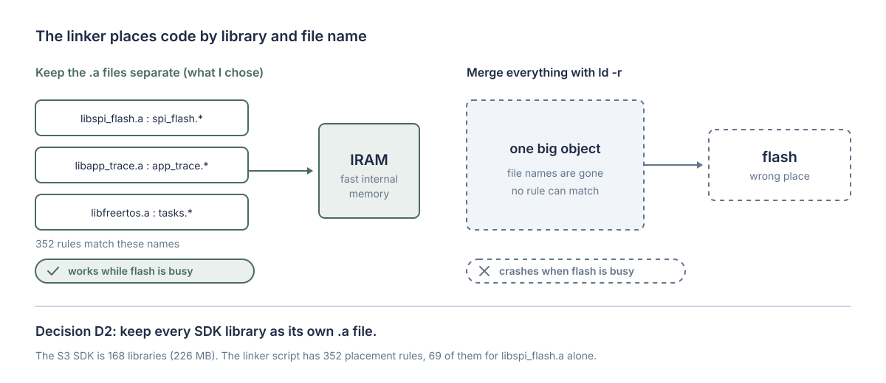
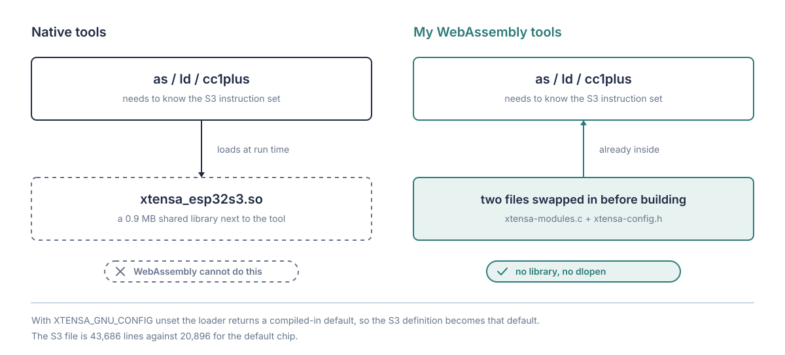
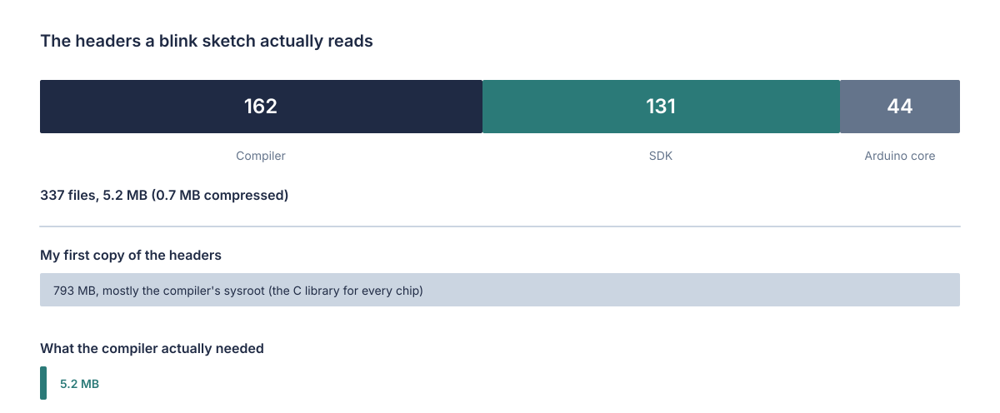
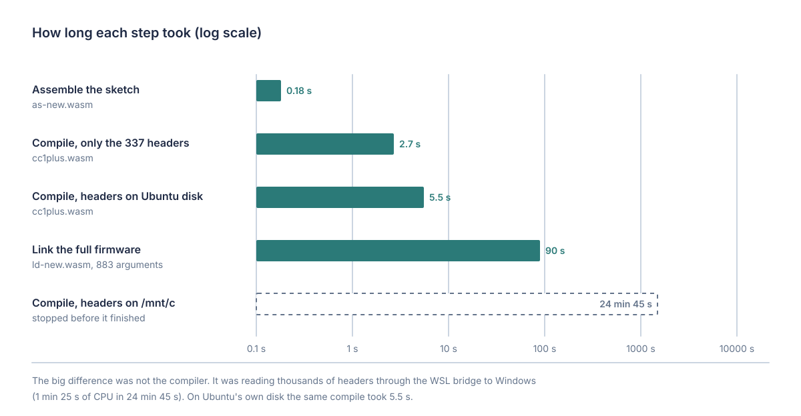
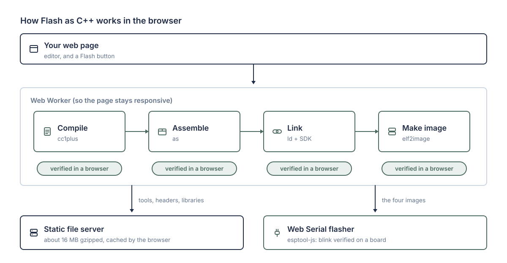
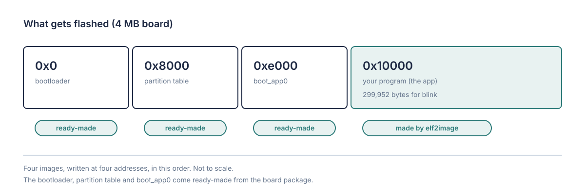

<div align="center">



<br>


**[How it works](#how-it-works) · [What's verified](#whats-verified) · [Use it](#use-it) · [WiFi and Bluetooth](#wifi-and-bluetooth) · [Build it](#build-the-toolchain) · [Docs](#documentation)**

</div>

<br>

Press a button on a web page, and your Arduino C++ is compiled, linked and flashed to an **ESP32-S3**, with nothing installed
and no server doing the compiling. Espressif's own **GCC 14.2** and **binutils 2.43** run as **WebAssembly** in a Web Worker; a
small JavaScript `elf2image` makes the flashable image; [esptool-js](https://github.com/espressif/esptool-js) writes it over
**Web Serial**.

It started as the "Flash as C++" feature of KaloLab (a MATLAB-like environment) and was split out because nothing like it
seemed to exist: I found no published GCC C++ compiler for Xtensa running as WebAssembly. The full story, with every decision
and dead end, is in [`docs/design-journal.docx`](docs/design-journal.docx).

> [!WARNING]
> **Beta.** Every stage is checked byte-for-byte against Espressif's native toolchain, and a blink sketch built by the browser
> compiler has run on a real **SparkFun ESP32-S3 Thing Plus**. **Nothing else has been tested on hardware** (no sensors, WiFi or
> BLE), and only one board profile exists. Read [What's verified](#whats-verified) before you rely on it, and please
> [report what you see](#help-wanted).

## At a glance

| | |
|---|---|
| **What it does** | C++ sketch → flashable image, entirely in the browser, then Web Serial to the board |
| **Compile time** | about 13 s for a blink sketch in a Chromium Worker (about 5–7 s of it is the C++ compile) |
| **First download** | about **16 MB** gzipped, about **23 MB** for a sketch that uses WiFi (the browser caches it); no server work per build |
| **Needs** | Chrome or Edge (Web Serial), an ESP32-S3 board, and memory for the compiler's 256 MB WebAssembly heap (untested on low-memory devices) |
| **Board profile** | SparkFun ESP32-S3 Thing Plus, Arduino-ESP32 core 3.3.12 (other boards need their own profile) |
| **Covers** | Arduino core, `Serial`, GPIO, PWM, ADC, RGB LED, tone, the C++ standard library, **WiFi, HTTP and HTTPS clients, BLE** |
| **Doesn't cover yet** | other Arduino libraries (web servers, MQTT, SD cards...) and sketches of more than one file (see [WiFi and Bluetooth](#wifi-and-bluetooth)) |

## How it works



1. **Compile.** `cc1plus.wasm` turns C++ into assembly. The Arduino headers arrive as a static bundle.
2. **Assemble and link.** `as` and `ld` (also WebAssembly) produce an ELF against the ESP32-S3 SDK libraries.
3. **Make the image.** `src/elf2image.js` builds the flash image the way `esptool elf2image` does.
4. **Flash.** `esptool-js` writes the bootloader, partition table, `boot_app0` and your program over Web Serial.

## What's verified

Verified on one PC, with the SparkFun ESP32-S3 Thing Plus board definition and Arduino-ESP32 core 3.3.12. The test is bytes:
if the WebAssembly tools give the same bytes as the native ones, they're right.

| Stage | Result | Status |
|---|---|---|
| Assemble (`as-new.wasm`) | **byte-for-byte identical** object file to the native assembler (after one Windows path was written with forward slashes) | Verified |
| Link (`ld-new.wasm`) | **byte-for-byte identical** 6,883,032-byte ELF to the native link, from 883 arguments and the full SDK | Verified |
| Link against a *thin* SDK | byte-for-byte identical ELF for 5 sample programs, using only the archive members they need | Verified |
| Compile (`cc1plus.wasm`) | the first 5,600 of 6,297 lines of assembly are identical to the native compiler's; the other 16 lines are debug-info strings (the compiler's flag list and the working-folder path) | Verified |
| `elf2image` | **byte-for-byte identical** to `esptool elf2image` for the blink ELF | Verified |
| Whole pipeline in a browser | blink: C++ → flashable image in about 13 s in a Chromium Worker. The image differs from the native one only in the embedded ELF hash (32 bytes), the checksum (1 byte) and the image digest (32 bytes), because the ELF's debug paths differ | Verified |
| **Flashing a real board and it running** | a blink sketch compiled by the browser toolchain was flashed to a SparkFun ESP32-S3 Thing Plus and blinked its on-board LED (reported by the author). Only blink was tried: no sensors, WiFi or BLE | Verified |
| Other browsers, phones, low-memory machines | untested (Safari and Firefox have no Web Serial) | Not tested |
| Other S3 boards | need their own profile | Not supported |
| Arduino's own WiFiScan, BasicHttpsClient and BLE Server examples | built in a browser Worker: the images have the same size as the Arduino IDE's, and differ only in the embedded ELF hash (32 bytes), the checksum and digest (33 bytes) and 6 or 7 build-timestamp bytes | Verified |
| Running WiFi, BLE, sensors (I2C, SPI) or other programs on a board | untested | Not tested |
| Other libraries (anything not listed above) | fail with a clear message at compile or link time | Not supported |

<p align="center"></p>

## Sizes

| | Uncompressed | Compressed |
|---|---|---|
| `cc1plus.wasm` (the C++ compiler) | 18.1–21 MB | 5–6.5 MB |
| `as-new.wasm`, `ld-new.wasm` | 1.1, 1.4 MB | 0.4, 0.4 MB |
| Headers (the 364 files a translated program reads) | 5.7 MB | 0.9 MB |
| Thin SDK libraries (base, with the BLE members) | 25 MB | about 7.5 MB gzip |
| WiFi, HTTP and BLE packs (library code and headers, one each) | 1.4, 2.2, 2.0 MB | 0.3, 0.4, 0.4 MB |
| Larger SDK variant, used only by WiFi sketches (replaces the base SDK) | 45 MB | 13.7 MB gzip |
| **Download in total** | about 50 MB | **about 16 MB gzipped, about 23 MB with WiFi** |

For comparison the whole ESP32-S3 SDK is 243 MB of libraries (67 MB gzipped); a blink needs 22.6 MB of it.

<p align="center"></p>

## Use it

You need the toolchain files served as static files (see [Build the toolchain](#build-the-toolchain)), then:

```js
import { buildCpp } from './src/cppbuild.js';
import { flashImages } from './src/flash.js';        // needs esptool-js (npm i) and a bundler

const { images } = await buildCpp(sketchText, (stage) => console.log(stage), { base: '/toolchain/esp32s3-thingplus/' });
const port = await navigator.serial.requestPort();   // Chrome or Edge
await flashImages(port, images, { onProgress: (fraction, phase) => {} });
```

`buildCpp` runs the Worker in `src/cppworker.js`. `images` is the bootloader, partition table, `boot_app0` and your program,
each with its flash address. A `.ino` sketch needs `#include <Arduino.h>` and function prototypes added first, as the Arduino
tools do: `inoToCpp(name, text)` in `src/ino.js` does that. Compiler errors come back as `error.log`.

A stand-alone page that runs the whole pipeline for blink, without flashing, is in [`demo/`](demo): `npm run demo`.

<details>
<summary><b><code>elf2image</code> on its own</b></summary>

<br>

`src/elf2image.js` has no dependencies and is useful by itself (browser or Node):

```js
import { elf2image } from './src/elf2image.js';
const bin = elf2image(elfBytes, { chip: 'esp32s3', flashMode: 'dio', flashFreq: '80m', flashSize: '4MB', elfSha256Offset: 0xb0 });
```

`npm test` checks its SHA-256 against Node's, a synthetic ELF's layout and alignment, the `.ino` preprocessing, and (when the
6.8 MB reference ELF is at `reference/gt_blink.ino.elf`, see [`build/README.md`](build/README.md)) the native toolchain's image
byte for byte.

</details>

## WiFi and Bluetooth

**Yes, for WiFi, HTTP/HTTPS clients and BLE, verified at build level.** The ESP32-S3 has **BLE only**, no Bluetooth Classic.
The compiler is the full Espressif one, so this is a packaging question: which libraries are shipped, and when they're fetched.

- **Feature packs.** A sketch that `#include`s `WiFi.h`, `HTTPClient.h` or a BLE header downloads that feature's pack (the Arduino
  library's compiled objects with debug info stripped, plus its headers) and, for WiFi, a larger SDK bundle. Other sketches
  never download them, so a blink stays at about 16 MB.
- **What I measured** (native Arduino builds of the examples for the same board, reading each linker map, and the packs I made):

| Example | Native app size | SDK archives | SDK members used | Gzipped |
|---|---|---|---|---|
| Blink-class sketches | 299,952 bytes | about 50 | 22.6 MB | about 7 MB |
| WiFiScan | 842,928 bytes | 66 | 42.1 MB | 12.9 MB |
| BasicHttpsClient (WiFi and TLS) | 1,028,704 bytes | 66 | 42.4 MB | 13.0 MB |
| BLE Server | 561,968 bytes | 49 | 23.2 MB | 7.0 MB |
| Union of all three | | 68 | 47.1 MB | 14.5 MB |

- **What's verified.** All three Arduino examples compile, link and make images in the browser (4.7 to 9.1 s). The images are the
  same size as the Arduino IDE's, and differ only in the embedded ELF hash, the checksum and digest, and 6 or 7 timestamp bytes
  (the native core copies were compiled at different times). The thin SDK variants also link every sample and example to the
  expected result (the base samples byte for byte; the native examples as images, for the same timestamp reason).
- **What isn't.** Nothing has run on a board: joining a WiFi network or advertising over BLE needs real hardware. Only the default
  partition table is flashed (1,310,720 bytes for the app), which fits all three examples (the largest is 1.03 MB); a larger
  program would need another partition table. The packs and the SDK bundle hold Espressif's precompiled library code: its licence is stated as Apache-2.0, but the Arduino
  package that ships it states none, so read the [licence review](docs/LICENCE_REVIEW.md) before you publish them.
- **Not covered:** other Arduino libraries (a web server, MQTT, SD...) and sketches of more than one file. A sketch using one gets
  a message naming the library.

## Build the toolchain

> [!NOTE]
> The WebAssembly tools are **not in the repository** (tens of MB). You build them, or download a release.

About 1–2 hours of compiling on a 16-thread machine, about 10 GB of disk, Ubuntu 24.04 (I used WSL 2), Emscripten 7.0.0, and
Espressif's binutils and GCC at the tags in [`SOURCE.md`](SOURCE.md). The scripts in [`build/`](build) are the exact ones I ran,
in order. They were written for one machine, with a native build of the same sketch as the reference ("ground truth"), and
their paths go through `build/env.sh` but aren't otherwise polished. **Treat them as a precise record of a working recipe, not
a one-command installer.** [`build/README.md`](build/README.md) walks through every step and lists the traps.

## Design decisions

<details>
<summary><b>Why GCC and GNU binutils, not clang/lld</b></summary>

<br>

The S3 link uses GNU-ld-only features (`--wrap`, `--orphan-handling`, ROM linker scripts) and a linker script with **352
placement rules** that match `*libX.a:object.*`. Real GCC and ld keep the behaviour identical.

<p align="center"></p>

Merging the SDK with `ld -r` would erase the file names those rules match, and code that must live in fast internal memory
would land in flash, crashing whenever flash is busy. So every SDK library stays a separate `.a`.

</details>

<details>
<summary><b>The chip definition is compiled in</b></summary>

<br>

Espressif's tools normally load a `xtensa_esp32s3.so` at run time (`dlopen`), which WebAssembly can't do. The loader returns a
compiled-in default when `XTENSA_GNU_CONFIG` is unset, so the S3 files from `xtensa-overlays` are swapped in before building.
No `.so`.

<p align="center"></p>

</details>

<details>
<summary><b>The thin SDK</b></summary>

<br>

A blink links 22.6 MB of members out of 243 MB. `build/build_profile.py` compiles and links sample programs against the full
SDK, reads the linker map, and keeps only the archive members used (everything else becomes an empty archive). Linking against
that gives the **identical ELF**. The catch is coverage: a feature none of the samples used (I hit it with `rgbLedWrite`) fails
to link until a sample that uses it is added.

<p align="center"></p>

</details>

<details>
<summary><b>The in-memory file system, and where the time goes</b></summary>

<br>

The tools are relinked with Emscripten's in-memory file system and `MODULARIZE`, so a Worker can write the headers and
libraries in, call `main`, and read the result. Reading thousands of headers through the WSL `/mnt/c` bridge was still not finished after 25
minutes, against 5.5 seconds on a local disk; the browser build avoids that class of problem by keeping everything in memory.

<p align="center"></p>

</details>

<details>
<summary><b>Where each piece runs</b></summary>

<br>

<p align="center"></p>

The four stages are verified in a browser; the Web Serial flasher is the part not yet tested on a board.

</details>

<details>
<summary><b>What gets flashed</b></summary>

<br>

<p align="center"></p>

</details>

## Repository layout

```
src/         elf2image.js · cppworker.js (the pipeline) · cppbuild.js (main-thread API) · flash.js (esptool-js) · ino.js (.ino → C++)
tests/       elf2image and .ino tests
build/       scripts that build and verify the toolchain and the profile, with the sample programs (see build/README.md)
demo/        a page and Worker that run the whole pipeline for blink
docs/        design journal (.docx), results, the native "ground truth" command lines, figures
reference/   the native blink image (.bin) and flash layout the tests compare against
```

## Documentation

| | |
|---|---|
| [`docs/design-journal.docx`](docs/design-journal.docx) | the full story: every decision, dead end and number |
| [`docs/RESULTS.md`](docs/RESULTS.md) | detailed results, sizes and how to re-run them |
| [`docs/GROUND_TRUTH.md`](docs/GROUND_TRUTH.md) | what the native toolchain does, captured |
| [`build/README.md`](build/README.md) | the build recipe, step by step, and the traps |
| [`SOURCE.md`](SOURCE.md) · [`THIRD_PARTY_NOTICES.md`](THIRD_PARTY_NOTICES.md) · [`RELEASING.md`](RELEASING.md) | licences, the GPL source offer, and the checklist for publishing binaries |

## Help wanted

- **Test more on real hardware and tell me what happens.** Blink works on a SparkFun ESP32-S3 Thing Plus. Still untested: WiFi and
  BLE sketches, I2C and SPI sensors, other boards, other browsers. Even "it doesn't boot" is useful: include the board, browser and
  the Device log.
- **Other ESP32-S3 boards:** a profile is one native capture plus `build/build_profile.py`.
- **WiFi and BLE on a real board,** and more libraries (web server, MQTT, SD...): each is a native build plus `build/build_packs.py` and `build/build_libpacks.py`.
- **On-demand loading** of SDK members instead of hand-picked packs (a trace showed raw range loading is too big; a member-level index is the idea worth trying).
- **Multi-file sketches and Arduino libraries** in the Worker.

## Licence

Code in this repository is **MIT** ([`LICENSE`](LICENSE)). The WebAssembly builds of GCC and binutils are **GPL**: if you
redistribute them you must offer their source ([`SOURCE.md`](SOURCE.md) has the exact tags and the checklist). SDK libraries
and the Arduino core keep their own licences ([`THIRD_PARTY_NOTICES.md`](THIRD_PARTY_NOTICES.md); what I found about the radio libraries is in [`docs/LICENCE_REVIEW.md`](docs/LICENCE_REVIEW.md)). Publishing built binaries:
[`RELEASING.md`](RELEASING.md). Not affiliated with or endorsed by Espressif, Arduino or SparkFun.
